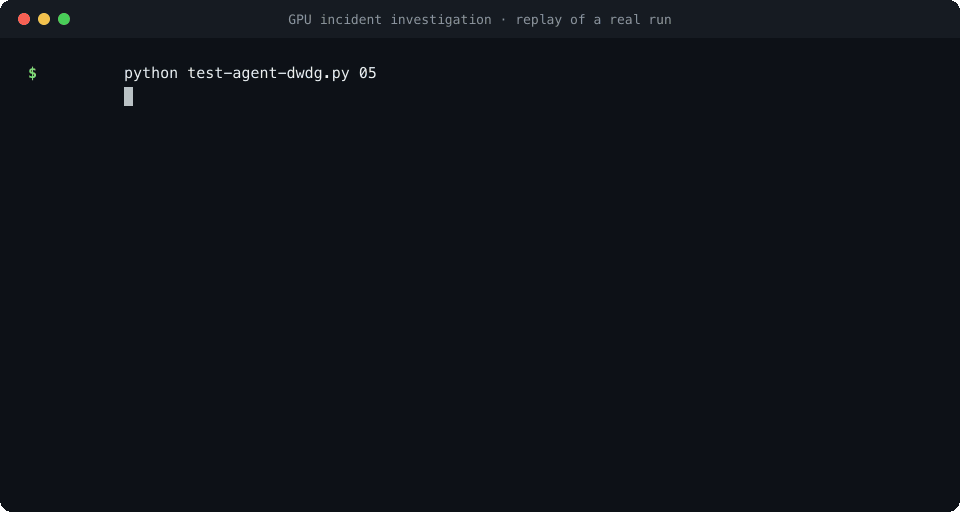
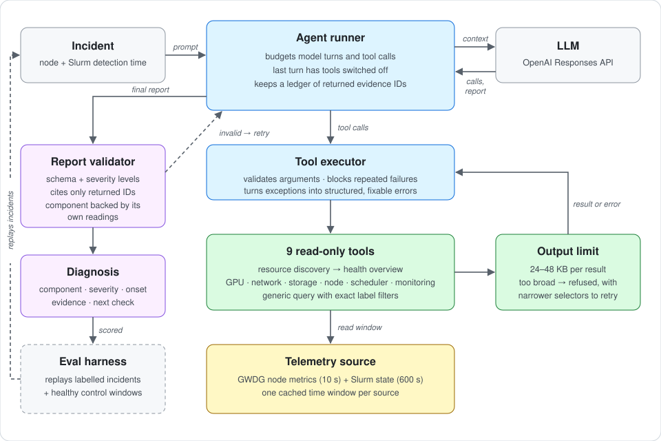

# ai-infra-agent

An LLM agent that investigates GPU node failures the way an on-call engineer would. It gets an incident, such as "Slurm marked this node unhealthy at 09:10", and works out from the node's telemetry what broke and when. It reports a severity, a suspected component, the evidence behind it, and the next useful check.

It runs on real data: the [GWDG GPU Node Telemetry Dataset](https://doi.org/10.5281/zenodo.21932615). The dataset covers 51 operator-labelled GPU incidents from a production HPC cluster, with 330 metrics at 10-second resolution and Slurm node state alongside.



## How it works



The agent uses the OpenAI Responses API with nine read-only tools. It first discovers the node's GPUs, NICs and disks, then reads a compact health overview, then drills into raw metrics where something looks off. The runner around the model keeps it honest:

- **Evidence is checked.** Every metric series a tool returns carries an evidence ID. A report may only cite IDs that a tool actually returned, and a "gpu" diagnosis must cite at least one GPU reading.
- **It always finishes.** Model turns and tool calls are budgeted. The last turn has tools switched off, so the agent writes a report from what it has, or says "unknown" and lists what's missing.
- **Errors are recoverable.** Bad arguments, oversized queries and missing data come back as structured errors with hints, rather than crashes. Repeating the same failed call is blocked.
- **Output is bounded.** A query that would flood the context is refused with a catalogue of narrower selectors, instead of being silently truncated.

## Evaluation

`src/dwdg/evaluation.py` replays historical incidents and adds healthy windows as controls. It scores whether the agent named the right component and whether its onset time falls between Slurm's last healthy check and its detection time.

An early live run of 3 incidents plus 1 control got one incident fully right. The misses were instructive. The agent took long-standing background states (a degraded systemd state, unused exporter collectors) for faults, and it could not use "the GPU metrics disappeared" as a signal. The control window also turned out not to be healthy: its GPUs were already reporting XID 79 hours before Slurm noticed. Those findings set the next round of work.

## Running it

Put the dataset in `data/GWDG_GPU_Node_Telemetry_Dataset_v2/` and set `OPENAI_API_KEY`.

```bash
python test-agent-dwdg.py 05                                  # one investigation
python -m src.dwdg.evaluation --limit 3 --negatives 1         # batch replay with a mock model
python -m src.dwdg.evaluation --live --workers 3              # batch replay with the real model
python -m unittest tests.test_gwdg_agent                      # tests (one module at a time)
```

Set `AGENT_LOG_LEVEL=DEBUG` to log full tool results. The tool layer is documented in [src/dwdg/README.md](src/dwdg/README.md).

## Next

Separate new faults from background states, treat vanished GPU telemetry as a signal, and propose safe remediation (cordon, drain, reset) through a policy layer instead of acting directly.

Dataset: Bidollahkhani, Nordsiek and Kunkel, GWDG GPU Node Telemetry Dataset, CC BY 4.0.
